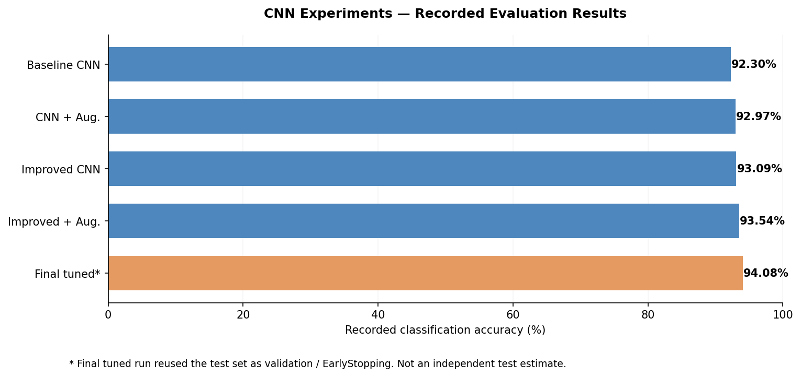
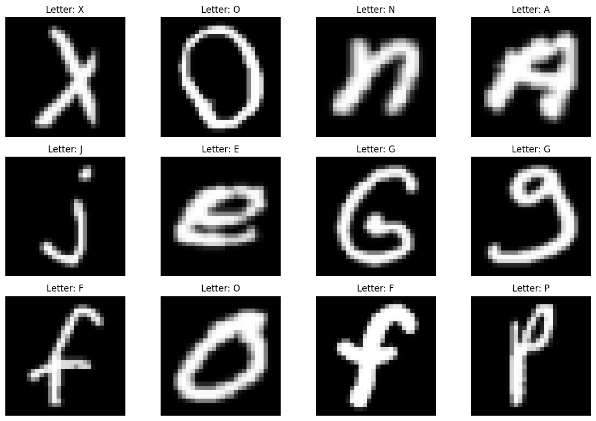
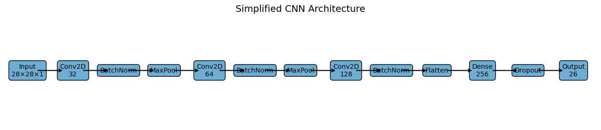
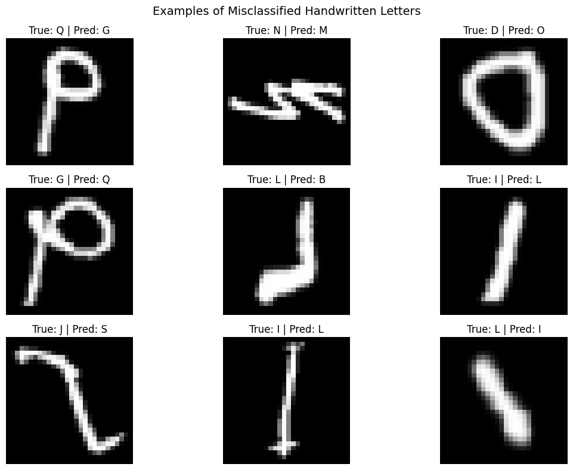

# Handwritten Letter Recognition with Convolutional Neural Networks

   

**A computer-vision study of CNN architectures for classifying 28 × 28 grayscale handwritten English letters across 26 classes.** This repository documents my individual deep learning experiments, evaluation, error analysis, and lessons about validation methodology.

## Project at a glance

- **Problem:** recognise handwritten letters despite variations in pen strokes and visually similar characters.
- **Data used:** 99,040 rows in the supplied CSV; 10,240 invalid-label rows removed, leaving **88,800** valid samples. Each row contains one label and 784 pixel values.
- **Methods:** baseline CNN; augmentation; a deeper CNN with Batch Normalization and Dropout; optimizer and learning-rate experiments.
- **Evaluation:** train/test stratified 80/20 split; some experiments also split training into training/validation subsets.
- **Main finding:** improved architecture + augmentation achieved **93.54%** on the originally separated test set (17,760 samples). A final tuned run recorded **94.08%**, but **reused test data as validation**, so it is not an independent estimate.



> **Methodology note:** The notebook is a historical student experiment, not a rigorously finalised benchmark. The 94.08% run used `X_test` in `validation_data` and EarlyStopping. In addition, comparing multiple candidates on one test set can introduce model-selection bias. Please read [VALIDATION_NOTES.md](VALIDATION_NOTES.md) before quoting results. A corrected train/validation/test pipeline is provided for future reruns; no new accuracy has been claimed for it.

## Selected experiments and recorded results

| Model | Recorded accuracy | Test loss | Notes |
|---|---:|---:|---|
| Baseline CNN | 92.30% | 0.2390 | Initial reference model |
| CNN + augmentation | 92.97% | 0.2080 | Rotation, shifting, zoom |
| Improved CNN | 93.09% | 0.2224 | Batch Normalization + Dropout |
| **Improved CNN + augmentation** | **93.54%** | **0.1948** | Strongest of four separately evaluated experiments |
| Final tuned CNN* | 94.08%* | 0.1792* | *Test set also used as validation; not independent* |

> These are **recorded outcomes from the original notebook**, not results from rerunning this repository package. A new unbiased performance claim requires a fresh, genuinely untouched evaluation dataset.

## Approach

1. **Inspect and clean:** identify invalid labels `-1` and `-2` in the school-provided CSV, retain labels 1–26, then map them to zero-based indices.
2. **Prepare images:** reshape 784 pixels to 28 × 28; normalise intensities to [0, 1] and apply the orientation correction used in the original workflow.
3. **Baseline model:** convolution/pooling blocks followed by fully connected layers, trained with Adam.
4. **Model improvements:** test augmentation and an enhanced architecture with a third convolutional block, Batch Normalization and Dropout.
5. **Evaluation:** compare accuracy/loss, inspect confusion matrices and difficult character pairs; note the methodological issue in the original tuned run.

### Examples and architecture

| Handwriting examples | CNN architecture |
|---|---|
|  |  |

### Error analysis

The original analysis highlighted confusions between letters with similar stroke patterns, particularly **I versus L** and **G versus Q**.



## Repository contents

```text
emnist-handwritten-letter-recognition/
├── README.md
├── emnist_cnn_experiments.ipynb  # annotated historical experiment, with saved plots
├── train_validation_safe.py    # corrected future training/evaluation pipeline
├── VALIDATION_NOTES.md         # metric interpretation and audit notes
├── requirements.txt
├── .gitignore
├── assets/                     # plots from notebook and documented comparison
└── models/
    ├── README.md
    └── legacy_final_tuned_weights.h5
```

## Running the project

**Recommended:** Python **3.10** in a virtual environment. The historical notebook used **TensorFlow 2.10.0** (the same major/minor release is pinned in requirements). A GPU is optional; CPU training may be slower.

```bash
python -m venv .venv
```

Activate on Windows (PowerShell):

```powershell
.venv\Scripts\Activate.ps1
```

Install dependencies:

```bash
python -m pip install -r requirements.txt
```

**Dataset:** The CSV originally used for this project was supplied through coursework and is **not redistributed here**. If you have permission to use it, place it at `emnist-letters.csv` in the repository root. The training script expects one label column plus 784 pixel columns, with valid labels 1–26 (and optional invalid labels -1/-2). Public EMNIST downloads may differ from the coursework CSV and may require adaptation; therefore the results above are not guaranteed to reproduce with another file.

Run the methodology-corrected script:

```bash
python train_validation_safe.py --data emnist-letters.csv
```

The script creates a stratified 80/20 train/test split, then reserves 20% of the training partition for validation. EarlyStopping uses **validation only**, and the held-out test split is evaluated **once** after training. It saves the trained model under `models/`, ignored by Git. **This script has been syntax-checked but has not been run against the original dataset in this portfolio preparation.**

Alternatively, open `emnist_cnn_experiments.ipynb` in Jupyter to review the original code, explanations and plots. Its outputs are **archived from the earlier run**. Running the historical notebook as-is will repeat its original validation/test overlap in the tuned experiment, so use the corrected script for new experiments.

## Limitations and future work

- The original tuned experiment reused the test set as validation; reported 94.08% is **not an untouched test score**.
- Selecting among multiple experimental results based on test-set performance risks optimistic estimates.
- Letter ambiguities persist, particularly I/L and G/Q.
- The supplied coursework dataset is not distributed; external datasets may not match preprocessing assumptions.
- Future work: repeat experiments with a fixed validation-only selection process and a genuinely independent final benchmark; add an inference demo after the validated model is ready.

## Credits and attribution

This is an **individual academic deep learning project** developed during my Diploma in Applied AI & Analytics at Singapore Polytechnic. Any third-party libraries and datasets remain subject to their own respective licences/terms. This repository includes my project implementation and selected generated plots, not the original assessment brief or the supplied dataset.

**Author:** [Yun Fei](https://github.com/tyunfei) · [LinkedIn](https://www.linkedin.com/in/toh-yun-fei/)